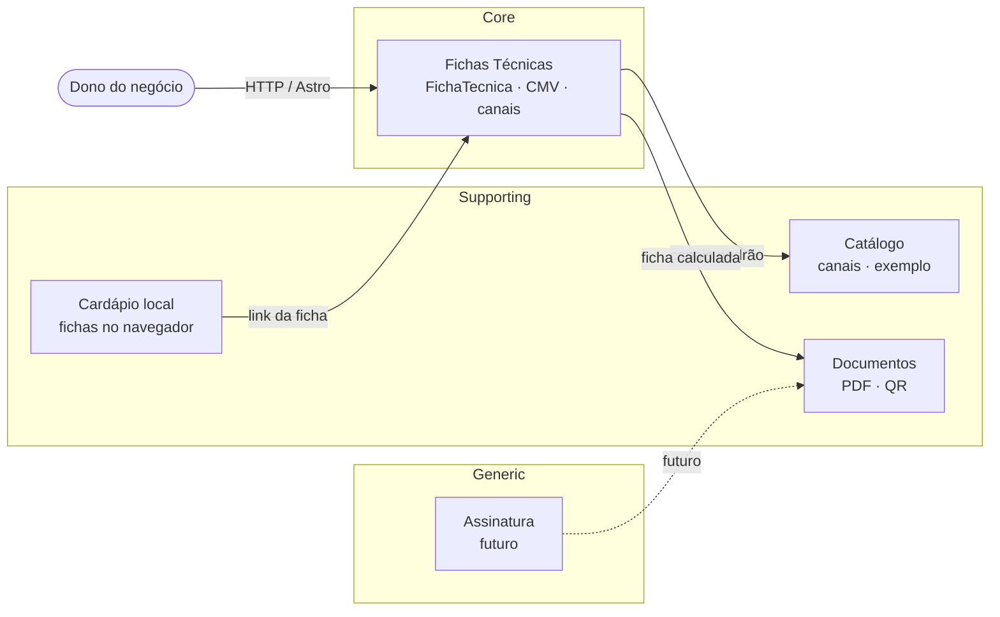

# Modelagem DDD — Cardápio no Lucro

## Por que DDD

A tela é uma ficha técnica. A regra é o que dá valor: **CMV, rendimento, rateio de custo fixo,
comissão por canal e preço mínimo**. Essa conta precisa ser única, testável e independente de UI,
PDF ou banco. O DDD separa o core (ficha/precificação) dos contextos de apoio (catálogo, PDF) e do
futuro contexto genérico de assinatura.

## Contextos



No MVP os contextos compartilham o processo e o banco, mas o domínio não conhece EF, Astro, PDF nem
cobrança. O schema `cardapio` isola a persistência.

## Linguagem ubíqua

| Termo | Significado |
| --- | --- |
| **Ficha técnica** | agregado de uma receita/prato com ingredientes, custos e canais |
| **Rendimento** | aproveitamento do ingrediente após limpeza/corte, em % |
| **Rendimento em porções** | quantas porções a receita inteira produz |
| **CMV** | custo dos ingredientes ÷ preço de venda |
| **CMV alvo** | CMV que o operador quer praticar |
| **Custo fixo rateado** | custos mensais ÷ porções vendidas no mês |
| **Canal** | salão, balcão, delivery próprio, iFood, 99Food |
| **Preço por CMV** | ingredientes por porção ÷ CMV alvo |
| **Preço mínimo** | preço que cobre todos os custos, imposto e taxa do canal |
| **Preço sugerido** | maior entre preço por CMV e preço mínimo, arredondado |
| **Margem de contribuição** | preço − custos variáveis − impostos − taxas do canal |
| **Lucro operacional** | margem de contribuição − mão de obra − custo fixo |

## Agregado `FichaTecnica`

Contém ingredientes, embalagens e canais. Toda mutação passa por `Criar`, `Atualizar` e `Calcular`.

Invariantes:

- Nome do prato obrigatório; rendimento entre 1 e 10.000 porções.
- Volume mensal entre 1 e 10.000.000 porções.
- Ingrediente com quantidade > 0, preço ≥ 0 e rendimento entre 0,01% e 100%.
- CMV alvo entre 0,01% e 90%.
- Ao menos um ingrediente, um canal e um canal ativo.
- Canal duplicado é rejeitado.
- `imposto + comissão do canal < 100%`.
- Custo total > 0 (não se calcula preço de uma ficha vazia).

Métodos:

```csharp
FichaTecnica.Criar(dados, id, shareToken, hashDoEditToken, agora)
ficha.Atualizar(dados, agora)
ResultadoDaFicha ficha.Calcular()
```

## Fórmula (fonte de verdade)

```
CustoIngredientesLote = Σ (qtd × preçoUnitário / rendimento)
CustoIngredientesPorcao = lote / porçõesDaReceita
CustoEmbalagemPorcao = Σ embalagens
CustoMaoDeObraPorcao = (minutos / 60 × valorHora) / porçõesDaReceita
CustoFixoPorcao = custosFixosMensais / porçõesVendidasNoMes
CustoTotalPorcao = soma dos quatro

PrecoPorCmv = CustoIngredientesPorcao / CMV alvo
PrecoMinimo = (CustoTotalPorcao + taxaFixa) / (1 − imposto − comissão)
PrecoSugerido = maior(PrecoPorCmv, PrecoMinimo), arredondado para cima
CMVReal = CustoIngredientesPorcao / PrecoSugerido
MargemContribuicao = Preço − impostos − comissão − taxaFixa
                      − ingredientes − embalagem
LucroOperacional = MargemContribuicao − mão de obra − custo fixo
```

O CMV é intencionalmente só de ingredientes. Embalagem é um custo variável separado; o preço mínimo
inclui tudo. Se o preço pelo CMV não cobrir os custos, ele é elevado ao mínimo e a resposta marca
`AjustadoPeloCustoTotal`.

## Decisões táticas

- **Centavos/pontos-base** nos value objects, como no Precifica.
- **Tokens opacos**: share token público, edit token privado com apenas SHA-256 persistido.
- **Canais no agregado**: a comissão altera o preço e precisa ser consistente com a ficha.
- **Catálogo estático**: os canais padrão e o exemplo são supporting; podem virar configuração por
  estabelecimento no futuro.
- **Meu cardápio local**: o MVP evita login; o navegador guarda os tokens das fichas criadas. Um
  workspace multiusuário é evolução, não requisito de validação.
- **Sem billing no MVP**: o produto está gratuito; o contexto de assinatura será separado.

## Limites e evolução

1. Catálogo compartilhado de ingredientes e recálculo de todo o cardápio em lote.
2. Workspace por estabelecimento com login e permissões.
3. Mais canais e importação de taxas/contratos.
4. Comparação de pratos e curva de lucro do menu.
5. Assinatura R$ 29–49/mês após validação.

## Testes como documentação

`CardapioNoLucro.Domain.Tests` cobre a fórmula e invariantes; `CardapioNoLucro.Application.Tests`
cobre mapeamento, tokens e criação/edição. Um teste que falha deve apontar uma regra de negócio, não
um detalhe de framework.
