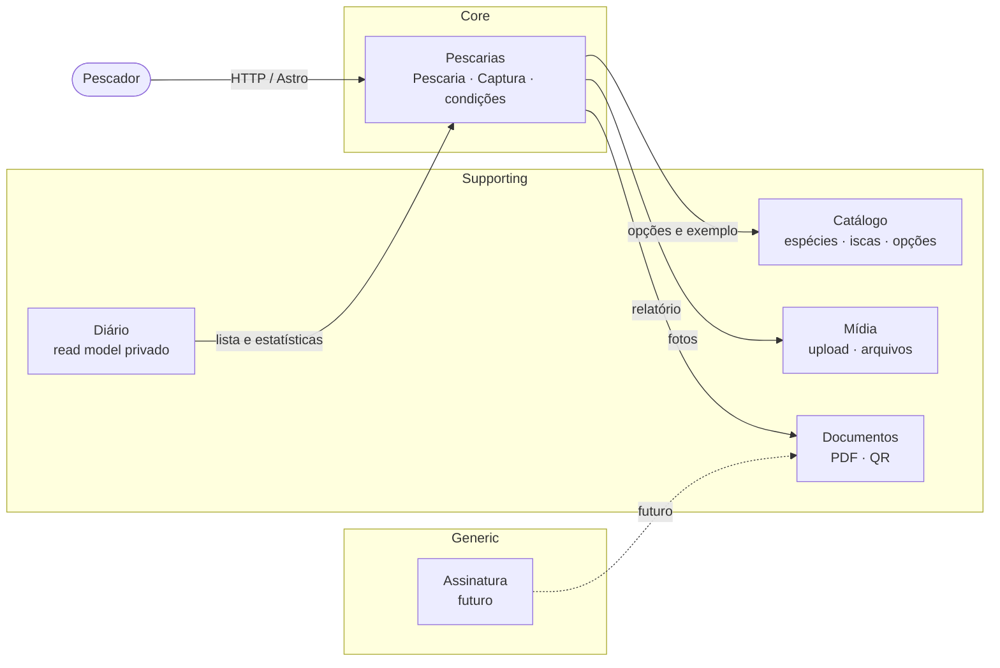

# Modelagem DDD — Fisga

## Por que DDD

O Fisga parece um caderno de fotos, mas o valor está em **capturar contexto**: local, condições,
isca, medidas e destino. É esse conjunto que permite comparar padrões e transformar uma captura em
troféu, relatório e estatística. O domínio precisa ser independente do navegador, do PDF, do
armazenamento de fotos e do futuro billing.

## Contextos

O diário **não é um agregado** no MVP: é uma leitura das pescarias que compartilham o hash do token
do diário. Isso evita um agregado que cresce sem limite e mantém cada pescaria pequena.

## Linguagem ubíqua

| Termo | Significado |
| --- | --- |
| **Pescaria** | saída de pesca com local, data, condições e capturas |
| **Captura** | peixe registrado, com ID próprio, medidas, isca e foto |
| **Diário** | conjunto privado de pescarias do mesmo token |
| **Troféu** | card visual de uma captura, com foto e dados |
| **Solto** | peixe devolvido à água |
| **Ambiente** | rio, mar, lagoa, represa, pesque-pague ou outro |
| **Condições** | lua, maré, clima e clareza da água |
| **Share token** | token público de uma pescaria |
| **Edit token** | token privado de edição (hash no banco) |
| **Diary token** | token privado que agrupa o diário no servidor |

## Agregado `Pescaria`

Contém as capturas. Toda mutação passa por `Criar` e `Atualizar`.

Invariantes:

- Local obrigatório (até 120 caracteres), UF com 2 letras quando informada.
- Data válida; enums de ambiente/período/condições definidos.
- Até 100 capturas; IDs únicos.
- Captura exige espécie, pelo menos peso **ou** comprimento, e foto apenas em `/media/`.
- Peso entre 0 e 1.000 kg; comprimento entre 0 e 500 cm.
- Uma captura existente mantém o ID ao ser editada; ID desconhecido é rejeitado.
- Pescaria sem captura é permitida (um dia de água também é memória).

### Identidade da captura

`Captura.Id` é um `Guid` explícito, gerado no domínio. Ele é usado no link
`/trofeu/{shareToken}/{capturaId}`. A edição preserva os IDs das capturas existentes e cria IDs
novos apenas para capturas novas. Isso evita links quebrados de troféu.

## Diário (read model)

- O cliente gera um token aleatório de 24 bytes e o guarda no `localStorage`.
- Cada `Pescaria` armazena apenas `SHA-256(diaryToken)`.
- `GET /api/diario` recebe `X-Diary-Token`, hasheia e busca as pescarias do diário.
- `ServicoDoDiario` calcula:
  - totais de pescarias, capturas, espécies e soltos;
  - maior peso e comprimento;
  - espécie/isca top (contagem e, no empate, maior peso);
  - local com mais capturas;
  - resumos ordenados por data.
- O link de backup (`/meu-diario?token=...`) permite abrir o diário em outro aparelho. É um segredo:
  quem tem o token tem acesso ao diário.

## Mídia

- `POST /api/midia` valida formulário, tamanho (5 MB) e tipo (`image/jpeg`, `image/png`,
  `image/webp`).
- O adaptador local salva em `Media:Path` com nome aleatório e devolve `/media/{nome}`.
- O domínio só aceita caminhos iniciados em `/media/`.
- O navegador comprime/reencoda a imagem antes do upload; isso também remove EXIF.
- Em produção, o diretório é um volume Docker. Trocar por S3 é uma implementação de `IMidiaStorage`.

## Documentos

`IGeradorDePdf` recebe `Pescaria` e gera o relatório com condições, troféu, capturas, notas e QR. O
PDF não depende do diário nem das fotos; ele é uma visão da pescaria.

O **card do troféu** é uma imagem gerada no navegador com Canvas, usando a foto e os dados da
captura. Isso evita um pipeline de imagem no servidor e mantém a personalização visual no cliente.

## Camadas

| Projeto | Pode depender de | Não pode |
| --- | --- | --- |
| `Fisga.Domain` | BCL | EF, ASP.NET, QuestPDF, storage |
| `Fisga.Application` | Domain, abstrações | Infrastructure, ASP.NET |
| `Fisga.Infrastructure` | Application, Domain, libs | Api |
| `Fisga.Api` | todas | — (composição) |

Portas: `IPescariaRepository`, `IMidiaStorage`, `IGeradorDePdf`, `IRelogio`,
`IDomainEventDispatcher`.

## Eventos

`PescariaRegistrada` é emitido na criação e hoje é consumido pelo dispatcher em processo (log). A
evolução natural é outbox para analytics, lembretes e e-mail.

## Limites e evolução

1. Sem login/workspace multiusuário; o token é a chave.
2. Sem sincronização automática de maré/clima; condições são registradas manualmente.
3. Catálogo de espécies/iscas estático e sugestivo, não uma validação taxonômica.
4. Card do troféu gerado no navegador; fotos precisam de CORS para o canvas.
5. Fotos ficam em volume local; para escala, mover para object storage + CDN.
6. Monetização futura separada (entitlement + gateway + webhooks).

## Testes

`Fisga.Domain.Tests` cobre invariantes, criação, edição e preservação de IDs.
`Fisga.Application.Tests` cobre casos de uso, token do diário e estatísticas. A experiência de foto,
troféu e edição foi validada ponta a ponta com Playwright.
