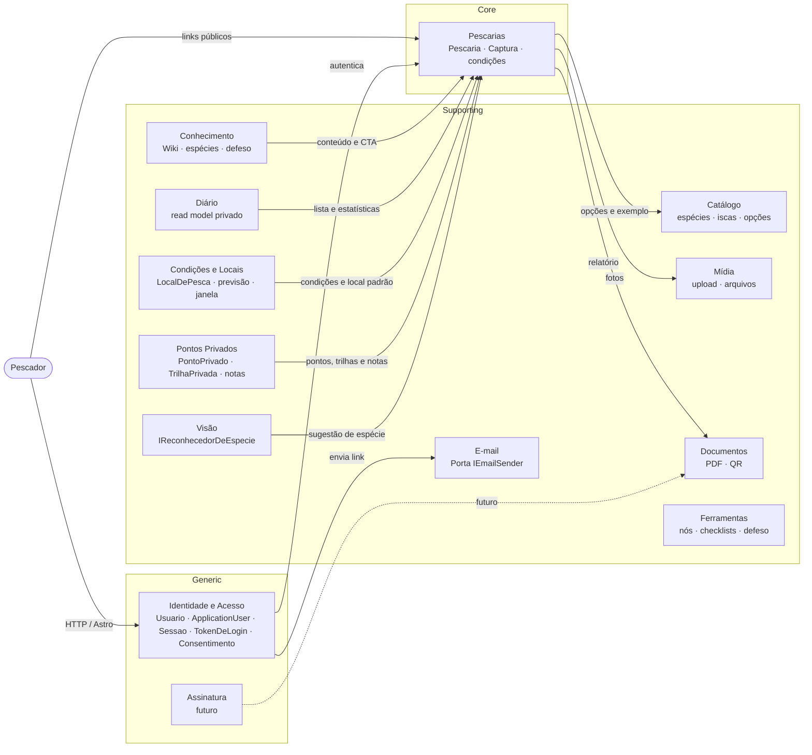

# Modelagem DDD — Fisga

## Por que DDD

O Fisga parece um caderno de fotos, mas o valor está em **capturar contexto**: local, condições,
isca, medidas e destino. É esse conjunto que permite comparar padrões e transformar uma captura em
troféu, relatório e estatística. O domínio precisa ser independente do navegador, do PDF, do
armazenamento de fotos, do provedor de e-mail e do futuro billing.

## Contextos

O diário **não é um agregado**: é uma leitura das pescarias do mesmo `UsuarioId`. Isso evita um
agregado que cresce sem limite e mantém cada pescaria pequena.

## Linguagem ubíqua

| Termo | Significado |
| --- | --- |
| **Pescaria** | saída de pesca com local, data, condições e capturas, sempre de um usuário |
| **Captura** | peixe registrado, com ID próprio, medidas, isca e foto |
| **Diário** | conjunto privado de pescarias do mesmo usuário |
| **Troféu** | card visual de uma captura, com foto e dados |
| **Solto** | peixe devolvido à água |
| **Ambiente** | rio, mar, lagoa, represa, pesque-pague ou outro |
| **Condições** | lua, maré, clima e clareza da água |
| **Usuário** | pescador com conta, identificado pelo e-mail normalizado |
| **Sessão** | registro de dispositivo/revogação ligado ao cookie `fisga_auth` pela claim `sessao_id` |
| **Link mágico** | token de uso único enviado por e-mail para entrar sem senha |
| **Consentimento** | aceite versionado de Termos e Privacidade, com tipo, versão e data |
| **Share token** | token público de uma pescaria |

Não existem mais `Diary token` nem `Edit token`: o diário e a edição são resolvidos pela sessão do
usuário. Links públicos continuam usando `shareToken`.

## Agregado `Pescaria`

Contém as capturas. Toda mutação passa por `Criar` e `Atualizar`.

Invariantes:

- `UsuarioId` obrigatório; toda pescaria pertence a uma conta.
- Local obrigatório (até 120 caracteres), UF com 2 letras quando informada e `CorpoOuTrecho`
  opcional com até 80 caracteres (erro `corpo_ou_trecho_longo`).
- `PrivacidadeDoLocal` define o que aparece publicamente em cinco níveis: `Exato` (o local),
  `Trecho` (o campo inteiro), `CorpoAgua` (até a primeira vírgula), `Cidade` (`Cidade · UF`)
  e `Oculto` ("Local não divulgado"). O padrão é `Cidade`; sem trecho/rio, `Trecho` e
  `CorpoAgua` caem para `Cidade`, nunca para `Local`. `LocalPublico`, `CidadePublica` e
  `EstadoPublico` são as únicas projeções usadas no link público, no troféu e no PDF.
- Data válida; enums de ambiente/período/condições definidos.
- Até 100 capturas; IDs únicos.
- Captura exige espécie, pelo menos peso **ou** comprimento, e fotos apenas em `/media/`.
- Até 4 fotos por captura; uma delas é a capa usada no troféu. A primeira é a capa padrão.
- Peso entre 0 e 1.000 kg; comprimento entre 0 e 500 cm.
- Uma captura existente mantém o ID ao ser editada; ID desconhecido é rejeitado.
- Pescaria sem captura é permitida (um dia de água também é memória).
- `PertenceA(usuarioId)` é a única forma de autorização de edição no agregado.

### Identidade da captura

`Captura.Id` é um `Guid` explícito, gerado no domínio. Ele é usado no link
`/trofeu/{shareToken}/{capturaId}`. A edição preserva os IDs das capturas existentes e cria IDs
novos apenas para capturas novas. Isso evita links quebrados de troféu.

## Identidade e Acesso

Contexto genérico, sem dependência de ASP.NET ou do provedor de e-mail no domínio. A autenticação é
feita pelo **ASP.NET Core Identity**; o domínio guarda o pescador e os fatos que o produto precisa.

### `Usuario` (agregado)

- `Id`, `Email` (value object normalizado), `Nome` opcional, `AceitaNovidades`.
- `EmailVerificadoEm`, `CriadoEm`, `AtualizadoEm`, `UltimoAcessoEm`, `BemVindoEm`.
- `Criar`, `VerificarEmail`, `RegistrarAcesso`, `AtualizarPerfil`, `MarcarBoasVindas`.
- Evento `UsuarioCriado`.

### `ApplicationUser` (Identity)

- `ApplicationUser : IdentityUser<Guid>` compartilha **o mesmo `Id`** do `Usuario`.
- Tabelas da Identity no schema `fisga` (`AspNetUsers`, `AspNetUserLogins`, etc.).
- `EmailVerificadoEm` é a fonte de verdade; `EmailConfirmed` espelha o estado.
- `SecurityStamp` é rotacionado em “sair de todos” e após troca de senha, como defesa em
  profundidade.

### `Sessao` (entidade de dispositivo)

- `Id`, `UsuarioId`, `TokenHash`, `UserAgent`, `IpHash`, `CriadoEm`, `UltimoUsoEm`, `ExpiraEm`,
  `RevogadaEm`.
- `TokenHash` guarda o SHA-256 do próprio `Id` (64 caracteres); não existe token cru.
- `EstaAtiva`, `RegistrarUso`, `Revogar`.
- Duração padrão: 30 dias, renovada pelo cookie da Identity.
- **Não autentica sozinha.** O cookie `fisga_auth` carrega a claim `sessao_id`; a cada `/api`
  autenticado o middleware busca a linha por PK, recusa sessão revogada/expirada e recusa
  `UsuarioId` diferente da claim `NameIdentifier`. `UltimoUsoEm` é atualizado no máximo a cada
  5 minutos.

### `TokenDeLogin` (entidade)

- `Id`, `Email`, `TokenHash`, `CriadoEm`, `ExpiraEm`, `UsadoEm`.
- `Criar`, `EstaValido`, `Consumir`, `Invalidar`.
- Validade padrão: 15 minutos. Uso único. Um novo pedido invalida os anteriores.

### `Consentimento` (entidade)

- `Id`, `UsuarioId`, `Tipo` (Termos/Privacidade), `Versao`, `AceitoEm`.
- As versões vigentes vêm de `Legal:TermsVersion`/`Legal:PrivacyVersion` (inicial `2026-11-17`).
- O aceite é lido do banco a cada requisição autenticada, sem claims de versão no cookie.

### Fluxos de autenticação

#### Cadastro e senha

1. `POST /api/auth/registrar` cria `Usuario` e `ApplicationUser` com o mesmo Id em uma transação e
   envia o link de confirmação.
2. O login por senha só é liberado com e-mail confirmado; `POST /api/auth/entrar` usa
   `CheckPasswordSignInAsync` e assina pela Identity.
3. Senha de 10 a 128 caracteres, sem exigir maiúscula, número ou símbolo. Lockout: 5 tentativas por
   15 minutos.
4. `POST /api/auth/esqueci-senha` responde de forma genérica; `POST /api/auth/redefinir-senha`
   consome o token, troca a senha e invalida sessões.

#### Link mágico

1. `POST /api/auth/solicitar` recebe o e-mail e sempre responde de forma genérica.
2. O serviço aplica um intervalo mínimo de reenvio (60 s em produção), invalida links pendentes e
   cria um token de 32 bytes; o banco guarda apenas o hash.
3. `IEmailSender` envia o link `${Auth:LinkBaseUrl}/api/auth/confirmar?token=...`.
4. `GET /api/auth/confirmar` consome o token, garante `Usuario` e `ApplicationUser`, confirma os dois
   lados do e-mail e assina com `IdentitySessionService`:
   - primeiro acesso → `/boas-vindas`;
   - demais → `/entrar/confirmar?estado=ok` → `/meu-diario`.
5. Em desenvolvimento, o link também aparece na resposta de `/api/auth/solicitar`.

#### Google (opcional)

- Sem `Google:ClientId`/`Google:ClientSecret`, o app boota, o botão fica oculto e `/iniciar`
  responde 503 `google_indisponivel`.
- `/api/auth/google/concluir` lê o `ExternalLoginInfo` do handler, exige e-mail Google verificado e
  resolve nesta ordem: vínculo existente → conta da mesma conta; e-mail local já verificado →
  vincula; e-mail local não verificado → recusa sem alterar nada; e-mail novo → cria conta e vínculo.
- `Adicionar login` nunca promove uma conta local não confirmada, para evitar tomada de conta.
- **Conectar Google** em `/conta` usa cookie de intenção protegido, exige o mesmo e-mail verificado,
  recusa `subject` já vinculado a outra conta e chama apenas `AddLoginAsync` — sem novo cookie nem
  nova sessão.

### Consentimento e sessão

- `/aceite` grava Termos e Privacidade da versão vigente via `POST /api/conta/consentimento`.
- Enquanto o aceite estiver pendente, todo `/api` responde 403 `consentimento_pendente`, exceto
  `GET /api/auth/me`, `POST /api/auth/sair` e `POST /api/conta/consentimento`. `/api/auth/me`
  devolve `consentimentoPendente` para o frontend redirecionar.
- Cookie `fisga_auth`: `HttpOnly`, `Secure` em produção, `SameSite=Lax`, 30 dias com renovação
  deslizante.
- A API e o site são same-site (`api.fisga.abson.tech` e `fisga.abson.tech`), então o cookie
  funciona com CORS `credentials`.
- CORS restrito às origens do site; mutações com `Origin` de outro site são rejeitadas.
- Rate limit específico para autenticação.
- Logout revoga a sessão atual; “sair de todos” revoga todas as linhas e rotaciona o security stamp.
- O cookie legado `fisga_sessao` é apagado no login/logout e **não autentica mais**.
- Chaves de Data Protection ficam em `DataProtection:KeysPath` e precisam de volume persistente.

### Conta

- `ServicoDeConta` exporta JSON (LGPD) e exclui a conta.
- A exclusão remove pescarias, sessões, o usuário, a conta Identity e os arquivos de foto referenciados.
- Exige confirmação digitada `EXCLUIR`.
- `POST /api/conta/senha` cria senha em conta sem senha ou troca exigindo a atual; a troca revoga as
  outras sessões e mantém a atual.
- `GET /api/conta/sessoes` lista dispositivos com `atual: true`.
- Não há endpoint para desconectar o Google nesta entrega.

## Diário (read model)

- `GET /api/diario` exige sessão e usa `UsuarioId`.
- `ServicoDoDiario` calcula:
  - totais de pescarias, capturas, espécies e soltos;
  - maior peso e comprimento;
  - espécie/isca top (contagem e, no empate, maior peso);
  - local com mais capturas;
  - resumos ordenados por data.
- Não há token nem link de backup: o e-mail é a recuperação.

## Condições e Locais

`LocalDePesca` é um agregado próprio, privado e limitado a cinco por usuário.

- Nome (até 80), cidade/UF, latitude/longitude e `AmbienteDePesca`.
- `ServicoDeLocais` garante ownership, limite de 5 e um único padrão por conta. Excluir o padrão
  promove o local mais recente restante.
- `ServicoDeCondicoes` agrega **Open-Meteo** (tempo, ondas e nível do mar) e **MET Norway** (lua:
  nascer, pôr, trânsito, anti-trânsito e ângulo de fase). O solunar e a janela são calculados na
  aplicação.
- `DadosDeCondicoes` é o modelo bruto do provedor; `CondicoesDto` é a projeção para a web.
- Cache em memória de 20 minutos por coordenada arredondada; a previsão é determinística dentro da
  janela.
- A maré é **aproximada** e sempre rotulada. Não é tábua oficial e não serve para navegação.
- A linha do tempo combina maré, pressão, vento e solunar em 24 h. A corrente vem do modelo
  (`ocean_current_velocity`) e é rotulada como estimativa.
- Mudanças bruscas de pressão geram um alerta textual, não uma promessa de captura.
- A janela tem nota 1–5 e motivos explícitos (solunar, direção da maré, vento, chuva, luz do dia e
  tendência de pressão). Não é uma promessa nem um número mágico.
- `/condicoes` é pública; preencher o registro e manter o rascunho no aparelho funcionam sem conta.
  Salvar no diário, salvar locais e comparar com o histórico exigem conta.
- `ServicoDeComparacao` usa lua, maré, clima e período para encontrar um dia parecido. Exige pelo
  menos 3 pescarias com captura; sem dados suficientes, devolve um estado honesto em vez de um
  padrão inventado.
- Locais salvos são privados. A página pública não expõe a conta de quem consulta.

## Pontos Privados

`PontoPrivado` é um agregado privado do pescador, separado de `LocalDePesca`.

- Nome, tipo (`Ponto`, `Poita`, `Estrutura`, `Trilha`, `Rampa`), notas, latitude e longitude.
- Limite de 200 por conta; ownership em toda operação.
- **Nenhum endpoint público** e nenhuma projeção pública. O ponto não entra em link, troféu ou PDF.
- O mapa é uma ferramenta de leitura/escrita; a camada de mapa não é dado do produto.
- Cache local dos pontos para consulta offline; ao detectar sessão inválida, o cache é apagado.
- Trilhas já são linha (até 500 pontos) com distância e GPX; raio e clustering ainda exigem
  PostGIS.
- Inteligência coletiva só por macrorregião/quadrante, opt-in e com amostra mínima.

## Ferramentas e Defeso

As ferramentas são conteúdo estático e offline, não um agregado de domínio.

- Nós e montagens: oito nós com passo a passo, uso e dica.
- Checklists: caiaque, costeira, embarcado e pesqueiro, com progresso em `localStorage`.
- Defeso: UF → órgão ambiental, checklist e links oficiais. O Fisga **não** mantém uma tabela
  própria de tamanhos mínimos nesta fase; a regra muda por bacia, ano e portaria.
- Registro: lembrete automático “confira tamanho mínimo e defeso de X em UF”, com link para o órgão.
- Guias: diretório em curadoria, sem cadastro automático nem pagamento.

## Visão Computacional

`IReconhecedorDeEspecie` é uma porta com duas implementações:

- `Manual`: padrão; devolve “confirme manualmente” e nunca inventa.
- `Gemini`: opcional via `Vision__Provider`, `Vision__ApiKey` e `Vision__Model`.

A resposta é limitada ao catálogo, com confiança e no máximo três sugestões. O pescador confirma ou
corrige; a IA não tem autoridade para gravar a espécie sozinha. O EXIF da foto é lido no navegador
apenas como sugestão de data/período e cidade/UF (GPS via Nominatim); nenhum campo é escrito antes
da confirmação explícita, o Aplicar só preenche campos vazios e `local` nunca recebe valor do GPS.
A coordenada não é armazenada.

## Conhecimento (Wiki do Pescador)

Contexto de apoio, editorial e público. Não participa das transações do diário; existe para educar,
atrair busca orgânica e levar o leitor ao registro.

- **Espécie**: nome popular/científico, família, habitat, distribuição, tamanho, época, iscas,
  técnicas, FAQ e fontes.
- **Técnica**: dificuldade, equipamento, passo a passo, erros, segurança e espécies-alvo.
- **Isca**: tipo (natural/artificial), quando usar, como montar, dicas e espécies-alvo.
- **Região**: UF, bioma, ambientes, espécies, melhores épocas, licença e segurança.
- **Guia**: defeso, iniciantes, segurança, glossário e fontes/metodologia.

Decisões:

- Conteúdo em Markdown tipado (Astro Content Collections), versionado no repositório.
- Páginas **estáticas** (`prerender = true`) para SEO, velocidade e cache offline.
- Busca **Pagefind** gerada no build; o índice é cacheado pelo service worker.
- Cada página tem resumo, data de revisão, fontes e, quando faz sentido, FAQ com JSON-LD.
- Regulamentação é tratada como **educativa**: links oficiais e aviso para confirmar no órgão
  ambiental. O Fisga ainda não valida automaticamente espécie + UF + data.
- O CTA “Registrar captura” leva a `/registrar?especie=...`; o formulário pré-preenche a primeira
  captura.
- A wiki não é um CMS multiusuário; contribuições e revisão por especialistas ficam para a evolução.

## Newsletter

A newsletter é um caso de uso da aplicação, não um contexto de domínio novo.

- `ServicoDeNewsletter` monta o digest mensal com estatísticas do diário (`ServicoDoDiario`) e três
  leituras sazonais da wiki.
- Só envia para usuários com `AceitaNovidades = true`.
- O link de descadastro é assinado com HMAC (`usuarioId.assinatura`), sem tabela extra.
- `POST /api/newsletter/enviar` exige `X-Admin-Token`; `GET /api/newsletter/preview` permite revisar
  o HTML; `GET /api/newsletter/descadastrar` desativa a preferência.
- O adaptador de e-mail é o mesmo `IEmailSender`; o envio real usa Resend com `List-Unsubscribe`.
- O agendamento mensal fica fora da aplicação (cron do servidor chamando o endpoint).

## Mídia

- `POST /api/midia` exige sessão, valida formulário, tamanho (5 MB) e tipo (`image/jpeg`,
  `image/png`, `image/webp`).
- O adaptador local salva em `Media:Path` com nome aleatório e devolve `/media/{nome}`.
- O domínio só aceita caminhos iniciados em `/media/`.
- O navegador comprime/reencoda a imagem antes do upload; isso também remove EXIF.
- Em produção, o diretório é um volume Docker. Trocar por S3 é uma implementação de `IMidiaStorage`.
- A exclusão de conta remove os arquivos referenciados.

## Documentos

`IGeradorDePdf` recebe `Pescaria` e gera o relatório com condições, troféu, capturas, notas e QR. O
PDF não depende do diário nem das fotos; ele é uma visão da pescaria.

O **card do troféu** é uma imagem gerada no navegador com Canvas, usando a foto e os dados da
captura. Isso evita um pipeline de imagem no servidor e mantém a personalização visual no cliente.

## E-mail

- Porta `IEmailSender` na aplicação.
- `ConsoleEmailSender` em desenvolvimento: loga apenas metadados seguros (domínio, assunto,
  expiração), nunca o link/token; o link é devolvido pela API em `linkDesenvolvimento`.
- `ResendEmailSender` em produção: usa a API do Resend com HTML e texto.
- O template é código da aplicação (`ModeloDeEmailDeAcesso`), não do provedor.
- Sem domínio verificado no Resend, só o e-mail dono da conta recebe. O domínio `abson.tech` precisa
  de MX/TXT/DKIM antes de abrir para o público.

## Camadas

| Projeto | Pode depender de | Não pode |
| --- | --- | --- |
| `Fisga.Domain` | BCL | EF, ASP.NET, QuestPDF, storage |
| `Fisga.Application` | Domain, abstrações | Infrastructure, ASP.NET |
| `Fisga.Infrastructure` | Application, Domain, libs | Api |
| `Fisga.Api` | todas | — (composição) |

Portas: `IPescariaRepository`, `IUsuarioRepository`, `ISessaoRepository`,
`ITokenDeLoginRepository`, `IUnitOfWork`, `IEmailSender`, `IMidiaStorage`, `IGeradorDePdf`,
`IRelogio`, `IDomainEventDispatcher`.

## Eventos

`PescariaRegistrada`, `UsuarioCriado`, `LoginSolicitado` e `SessaoIniciada` são emitidos no domínio
e hoje consumidos pelo dispatcher em processo (log). A evolução natural é outbox para analytics,
lembretes e e-mail.

## Limites e evolução

1. Sem senha e sem login social; o link mágico é o único método. Google OAuth é o próximo atalho.
2. Sem verificação de e-mail em dois canais; o próprio link prova a posse do endereço.
3. A maré vem de modelo global e é aproximada; a tábua oficial do CHM para os 44 portos fica para a
   próxima fase. Condições registradas à mão continuam prevalecendo no diário.
4. Catálogo de espécies/iscas estático e sugestivo, não uma validação taxonômica.
5. Card do troféu gerado no navegador; fotos precisam de CORS para o canvas.
6. Fotos ficam em volume local; para escala, mover para object storage + CDN.
7. Monetização futura separada (entitlement + gateway + webhooks).
8. A wiki é editorial e estática; não há edição pela comunidade nem validação automática de defeso
   por espécie/UF/data. Essas são evoluções naturais.
9. A newsletter não tem idempotência por mês; o endpoint deve ser chamado uma vez pelo cron.
10. O limite de fotos é 4 por captura; armazenamento local por volume, sem CDN.
11. O cache de condições é em memória e por instância; múltiplas réplicas exigem cache distribuído.
12. A janela de pesca é uma heurística explicável, não um modelo treinado; precisa de validação com
    pescadores antes de prometer precisão.
13. Pontos privados usam latitude/longitude simples; consultas por raio, trilhas e clustering
    dependem de PostGIS.
14. O mapa usa tiles de terceiros e não funciona offline; mapas offline por área ficam para a
    próxima fase.
15. A biblioteca de nós, checklists e defeso por UF existem; o diretório de guias ainda está em
    curadoria e não há tabela própria de tamanhos mínimos.
16. A sugestão de espécie depende de provedor externo; sem chave, o fluxo é manual.
17. O cache de azulejos é limitado e não substitui mapas offline por área.

## Testes

`Fisga.Domain.Tests` cobre invariantes, criação, edição, preservação de IDs e ownership.
`Fisga.Application.Tests` cobre casos de uso, link mágico, expiração, uso único, sessão, logout,
isolamento entre usuários, exclusão, exportação, locais salvos, agregação de condições, lua/solunar,
janela, comparação com o histórico e pontos privados. `Fisga.Api.Tests` cobre a API (identidade,
consentimento, senha, sessões, Google e outbox) e a resolução da versão exposta em `/health`. A
experiência completa (login, onboarding, registro, foto, troféu, PDF, conta, condições, locais, mapa
e logout) é validada com Playwright: 150 testes mockados no CI e 6 com backend real via
`scripts/e2e-real.sh`.
