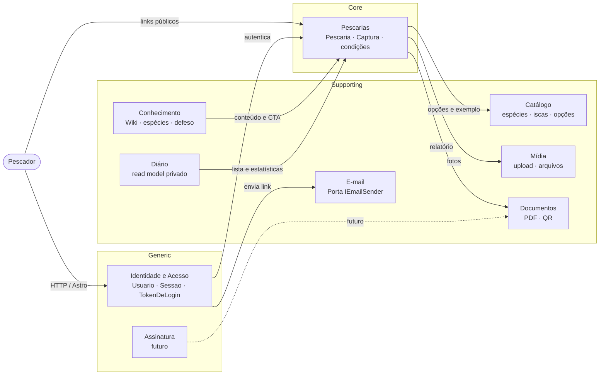

# Modelagem DDD — Fisga

## Por que DDD

O Fisga parece um caderno de fotos, mas o valor está em **capturar contexto**: local, condições,
isca, medidas e destino. É esse conjunto que permite comparar padrões e transformar uma captura em
troféu, relatório e estatística. O domínio precisa ser independente do navegador, do PDF, do
armazenamento de fotos, do provedor de e-mail e do futuro billing.

## Contextos

O diário **não é um agregado**: é uma leitura das pescarias do mesmo `UsuarioId`. Isso evita um
agregado que cresce sem limite e mantém cada pescaria pequena.

## Linguagem ubíqua

| Termo | Significado |
| --- | --- |
| **Pescaria** | saída de pesca com local, data, condições e capturas, sempre de um usuário |
| **Captura** | peixe registrado, com ID próprio, medidas, isca e foto |
| **Diário** | conjunto privado de pescarias do mesmo usuário |
| **Troféu** | card visual de uma captura, com foto e dados |
| **Solto** | peixe devolvido à água |
| **Ambiente** | rio, mar, lagoa, represa, pesque-pague ou outro |
| **Condições** | lua, maré, clima e clareza da água |
| **Usuário** | pescador com conta, identificado pelo e-mail normalizado |
| **Sessão** | acesso autenticado de um dispositivo; guardada por hash no banco |
| **Link mágico** | token de uso único enviado por e-mail para entrar sem senha |
| **Share token** | token público de uma pescaria |

Não existem mais `Diary token` nem `Edit token`: o diário e a edição são resolvidos pela sessão do
usuário. Links públicos continuam usando `shareToken`.

## Agregado `Pescaria`

Contém as capturas. Toda mutação passa por `Criar` e `Atualizar`.

Invariantes:

- `UsuarioId` obrigatório; toda pescaria pertence a uma conta.
- Local obrigatório (até 120 caracteres), UF com 2 letras quando informada.
- `PrivacidadeDoLocal` define o que aparece publicamente: local exato, cidade/UF ou oculto.
  `LocalPublico`, `CidadePublica` e `EstadoPublico` são as únicas projeções usadas no link
  público, no troféu e no PDF.
- Data válida; enums de ambiente/período/condições definidos.
- Até 100 capturas; IDs únicos.
- Captura exige espécie, pelo menos peso **ou** comprimento, e fotos apenas em `/media/`.
- Até 4 fotos por captura; uma delas é a capa usada no troféu. A primeira é a capa padrão.
- Peso entre 0 e 1.000 kg; comprimento entre 0 e 500 cm.
- Uma captura existente mantém o ID ao ser editada; ID desconhecido é rejeitado.
- Pescaria sem captura é permitida (um dia de água também é memória).
- `PertenceA(usuarioId)` é a única forma de autorização de edição no agregado.

### Identidade da captura

`Captura.Id` é um `Guid` explícito, gerado no domínio. Ele é usado no link
`/trofeu/{shareToken}/{capturaId}`. A edição preserva os IDs das capturas existentes e cria IDs
novos apenas para capturas novas. Isso evita links quebrados de troféu.

## Identidade e Acesso

Contexto genérico, sem dependência de ASP.NET ou do provedor de e-mail.

### `Usuario` (agregado)

- `Id`, `Email` (value object normalizado), `Nome` opcional, `AceitaNovidades`.
- `EmailVerificadoEm`, `CriadoEm`, `AtualizadoEm`, `UltimoAcessoEm`, `BemVindoEm`.
- `Criar`, `VerificarEmail`, `RegistrarAcesso`, `AtualizarPerfil`, `MarcarBoasVindas`.
- Evento `UsuarioCriado`.

### `Sessao` (entidade)

- `Id`, `UsuarioId`, `TokenHash`, `UserAgent`, `IpHash`, `CriadoEm`, `UltimoUsoEm`, `ExpiraEm`,
  `RevogadaEm`.
- `EstaAtiva`, `RegistrarUso`, `Revogar`.
- Duração padrão: 30 dias. O token cru vive apenas no cookie `HttpOnly`; o banco guarda SHA-256.

### `TokenDeLogin` (entidade)

- `Id`, `Email`, `TokenHash`, `CriadoEm`, `ExpiraEm`, `UsadoEm`.
- `Criar`, `EstaValido`, `Consumir`, `Invalidar`.
- Validade padrão: 15 minutos. Uso único. Um novo pedido invalida os anteriores.

### Fluxo do link mágico

1. `POST /api/auth/solicitar` recebe o e-mail e sempre responde de forma genérica.
2. O serviço aplica um intervalo mínimo de reenvio (60 s em produção), invalida links pendentes e
   cria um token de 32 bytes; o banco guarda apenas o hash.
3. `IEmailSender` envia o link `${Auth:LinkBaseUrl}/api/auth/confirmar?token=...`.
4. `GET /api/auth/confirmar` consome o token, cria ou localiza o usuário, verifica o e-mail, cria a
   sessão, define o cookie e redireciona:
   - primeiro acesso → `/boas-vindas`;
   - demais → `/entrar/confirmar?estado=ok` → `/meu-diario`.
5. Em desenvolvimento, o link também aparece na resposta de `/api/auth/solicitar` para testes.

### Sessão e segurança

- Cookie `HttpOnly`, `Secure` em produção, `SameSite=Lax`, validade de 30 dias.
- A API e o site são same-site (`api.fisga.abson.tech` e `fisga.abson.tech`), então o cookie
  funciona com CORS `credentials` e `SameSite=Lax`.
- CORS restrito às origens do site; mutações com `Origin` de outro site são rejeitadas.
- Rate limit específico para autenticação.
- Logout revoga a sessão no servidor; “sair de todos” revoga todas.
- Respostas de solicitação não revelam se o e-mail existe.

### Conta

- `ServicoDeConta` exporta JSON (LGPD) e exclui a conta.
- A exclusão remove pescarias, sessões, o usuário e os arquivos de foto referenciados.
- Exige confirmação digitada `EXCLUIR`.

## Diário (read model)

- `GET /api/diario` exige sessão e usa `UsuarioId`.
- `ServicoDoDiario` calcula:
  - totais de pescarias, capturas, espécies e soltos;
  - maior peso e comprimento;
  - espécie/isca top (contagem e, no empate, maior peso);
  - local com mais capturas;
  - resumos ordenados por data.
- Não há token nem link de backup: o e-mail é a recuperação.

## Conhecimento (Wiki do Pescador)

Contexto de apoio, editorial e público. Não participa das transações do diário; existe para educar,
atrair busca orgânica e levar o leitor ao registro.

- **Espécie**: nome popular/científico, família, habitat, distribuição, tamanho, época, iscas,
  técnicas, FAQ e fontes.
- **Técnica**: dificuldade, equipamento, passo a passo, erros, segurança e espécies-alvo.
- **Isca**: tipo (natural/artificial), quando usar, como montar, dicas e espécies-alvo.
- **Região**: UF, bioma, ambientes, espécies, melhores épocas, licença e segurança.
- **Guia**: defeso, iniciantes, segurança, glossário e fontes/metodologia.

Decisões:

- Conteúdo em Markdown tipado (Astro Content Collections), versionado no repositório.
- Páginas **estáticas** (`prerender = true`) para SEO, velocidade e cache offline.
- Busca **Pagefind** gerada no build; o índice é cacheado pelo service worker.
- Cada página tem resumo, data de revisão, fontes e, quando faz sentido, FAQ com JSON-LD.
- Regulamentação é tratada como **educativa**: links oficiais e aviso para confirmar no órgão
  ambiental. O Fisga ainda não valida automaticamente espécie + UF + data.
- O CTA “Registrar captura” leva a `/registrar?especie=...`; o formulário pré-preenche a primeira
  captura.
- A wiki não é um CMS multiusuário; contribuições e revisão por especialistas ficam para a evolução.

## Newsletter

A newsletter é um caso de uso da aplicação, não um contexto de domínio novo.

- `ServicoDeNewsletter` monta o digest mensal com estatísticas do diário (`ServicoDoDiario`) e três
  leituras sazonais da wiki.
- Só envia para usuários com `AceitaNovidades = true`.
- O link de descadastro é assinado com HMAC (`usuarioId.assinatura`), sem tabela extra.
- `POST /api/newsletter/enviar` exige `X-Admin-Token`; `GET /api/newsletter/preview` permite revisar
  o HTML; `GET /api/newsletter/descadastrar` desativa a preferência.
- O adaptador de e-mail é o mesmo `IEmailSender`; o envio real usa Resend com `List-Unsubscribe`.
- O agendamento mensal fica fora da aplicação (cron do servidor chamando o endpoint).

## Mídia

- `POST /api/midia` exige sessão, valida formulário, tamanho (5 MB) e tipo (`image/jpeg`,
  `image/png`, `image/webp`).
- O adaptador local salva em `Media:Path` com nome aleatório e devolve `/media/{nome}`.
- O domínio só aceita caminhos iniciados em `/media/`.
- O navegador comprime/reencoda a imagem antes do upload; isso também remove EXIF.
- Em produção, o diretório é um volume Docker. Trocar por S3 é uma implementação de `IMidiaStorage`.
- A exclusão de conta remove os arquivos referenciados.

## Documentos

`IGeradorDePdf` recebe `Pescaria` e gera o relatório com condições, troféu, capturas, notas e QR. O
PDF não depende do diário nem das fotos; ele é uma visão da pescaria.

O **card do troféu** é uma imagem gerada no navegador com Canvas, usando a foto e os dados da
captura. Isso evita um pipeline de imagem no servidor e mantém a personalização visual no cliente.

## E-mail

- Porta `IEmailSender` na aplicação.
- `ConsoleEmailSender` em desenvolvimento: imprime o link no log.
- `ResendEmailSender` em produção: usa a API do Resend com HTML e texto.
- O template é código da aplicação (`ModeloDeEmailDeAcesso`), não do provedor.
- Sem domínio verificado no Resend, só o e-mail dono da conta recebe. O domínio `abson.tech` precisa
  de MX/TXT/DKIM antes de abrir para o público.

## Camadas

| Projeto | Pode depender de | Não pode |
| --- | --- | --- |
| `Fisga.Domain` | BCL | EF, ASP.NET, QuestPDF, storage |
| `Fisga.Application` | Domain, abstrações | Infrastructure, ASP.NET |
| `Fisga.Infrastructure` | Application, Domain, libs | Api |
| `Fisga.Api` | todas | — (composição) |

Portas: `IPescariaRepository`, `IUsuarioRepository`, `ISessaoRepository`,
`ITokenDeLoginRepository`, `IUnitOfWork`, `IEmailSender`, `IMidiaStorage`, `IGeradorDePdf`,
`IRelogio`, `IDomainEventDispatcher`.

## Eventos

`PescariaRegistrada`, `UsuarioCriado`, `LoginSolicitado` e `SessaoIniciada` são emitidos no domínio
e hoje consumidos pelo dispatcher em processo (log). A evolução natural é outbox para analytics,
lembretes e e-mail.

## Limites e evolução

1. Sem senha e sem login social; o link mágico é o único método. Google OAuth é o próximo atalho.
2. Sem verificação de e-mail em dois canais; o próprio link prova a posse do endereço.
3. Sem sincronização automática de maré/clima; condições são registradas manualmente.
4. Catálogo de espécies/iscas estático e sugestivo, não uma validação taxonômica.
5. Card do troféu gerado no navegador; fotos precisam de CORS para o canvas.
6. Fotos ficam em volume local; para escala, mover para object storage + CDN.
7. Monetização futura separada (entitlement + gateway + webhooks).
8. A wiki é editorial e estática; não há edição pela comunidade nem validação automática de defeso
   por espécie/UF/data. Essas são evoluções naturais.
9. A newsletter não tem idempotência por mês; o endpoint deve ser chamado uma vez pelo cron.
10. O limite de fotos é 4 por captura; armazenamento local por volume, sem CDN.

## Testes

`Fisga.Domain.Tests` cobre invariantes, criação, edição, preservação de IDs e ownership.
`Fisga.Application.Tests` cobre casos de uso, link mágico, expiração, uso único, sessão, logout,
isolamento entre usuários, exclusão e exportação. A experiência completa (login, onboarding,
registro, foto, troféu, PDF, conta e logout) é validada com Playwright.
