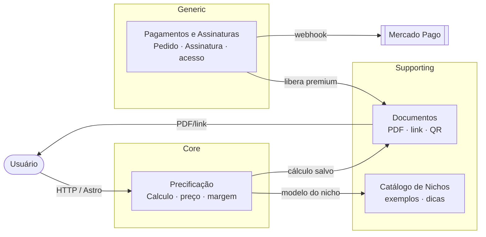

# Modelagem DDD — Precifica

## Por que DDD em uma “calculadora”

O formulário é simples. A **regra de preço não é**. Margem sobre o preço, impostos e taxas que
incidem no valor final, rateio de custo fixo por hora produtiva, perda de material, arredondamento
para cima e preço mínimo formam o núcleo que diferencia o produto. É esse conjunto que precisa ser
explicável, testável e difícil de quebrar — não a tela.

O DDD aqui serve para:

- manter a fórmula em um lugar único, independente de UI, banco e gateway;
- proteger invariantes que evitam prejuízo silencioso (ex.: soma de percentuais ≥ 100%);
- separar o **core** (precificação) de contextos de apoio (catálogo, PDF) e genéricos (pagamento);
- permitir evolução (novos nichos, marca própria, histórico) sem reescrever o cálculo.

## Mapa de contextos



| Contexto | Tipo | Dono dos dados | Relação |
| --- | --- | --- | --- |
| Precificação | Core | `Calculo` | expõe cálculo e resultado; não conhece pagamento |
| Catálogo | Supporting | modelos em memória | fornece exemplo, dica e nome do nicho |
| Documentos | Supporting | nada persistido | lê `Calculo` e o status de acesso, gera PDF |
| Pagamentos | Generic | `Pedido`, `Assinatura` | ACL do Mercado Pago; responde “tem acesso premium?” |

No MVP os contextos compartilham o mesmo processo e banco, mas **não compartilham tabelas**:
`precificacao.*` e `pagamentos.*`. A separação em projetos/schemas preserva a opção de extrair um
serviço depois.

## Linguagem ubíqua

| Termo | Significado no código |
| --- | --- |
| **Cálculo** | agregado que representa um produto/serviço precificado |
| **Preço sugerido** | preço final que preserva a margem desejada |
| **Preço mínimo** | preço que cobre custos, impostos e taxas, sem lucro |
| **Margem** | lucro sobre o **preço final**; não confundir com markup |
| **Custo fixo rateado** | parte dos custos mensais alocada ao tempo do cálculo |
| **Perda** | percentual de desperdício aplicado aos materiais |
| **Nicho** | segmento do negócio (confeitaria, artesanato, 3D, estética) |
| **Share token** | token público do link/PDF |
| **Edit token** | token privado de edição; o banco guarda apenas o hash |
| **Pedido** | compra avulsa do PDF sem marca d’água |
| **Assinatura** | plano Pro mensal vinculado ao e-mail |
| **Acesso premium** | direito de baixar PDF sem marca (pedido pago ou assinatura ativa) |

## Agregados e invariantes

### `Calculo` (raiz)

Contém materiais, custos extras, tempo, custos fixos, percentuais e arredondamento. Toda mutação
passa por `Criar`, `Atualizar` ou `Calcular`.

Invariantes:

- `QuantidadeProduzida` entre 1 e 100.000.
- Tempo entre 0 e 744 h; valor/hora e custos não negativos.
- Percentuais entre 0 e 100; margem até 99,99%.
- `margem + imposto + taxa do cartão < 100%` (senão o preço explode/é inválido).
- Se há custo fixo, `horasProdutivasPorMes > 0`.
- Cálculo precisa ter algum custo ou tempo (não se calcula preço de nada).
- `ShareToken` e `EditTokenHash` obrigatórios.
- O resultado é **derivado** e recalculado; não é persistido como fonte de verdade.

Métodos:

```csharp
Calculo.Criar(dados, id, shareToken, hashDoEditToken, agora)
calculo.Atualizar(dados, agora)
ResultadoDaPrecificacao calculo.Calcular()
```

### `Pedido` (raiz)

Compra avulsa vinculada a um cálculo e a um e-mail.

- Começa `Pendente`; só recebe pagamento uma vez.
- `ConfirmarPagamento` é **idempotente**: webhooks repetidos não duplicam eventos.
- Valor pago menor que o pedido é rejeitado.
- Evento `PagamentoConfirmado` é emitido apenas na transição.

### `Assinatura` (raiz)

Plano Pro mensal vinculado ao e-mail.

- `Pendente → Ativa` ao receber `preapproval` autorizado.
- Reativação repetida não encurta nem estende um período vigente.
- Período vencido remove o acesso mesmo que o status ainda seja `Ativa`.
- `Cancelada` não é reativada pelo fluxo automático.

## Fórmula (fonte de verdade)

```
materiaisBrutos = Σ (quantidade × custoUnitário)
perda           = materiaisBrutos × perda%
custoMateriais  = materiaisBrutos + perda

custoMaoDeObra  = (minutos / 60) × valorHora
custoFixo       = custosFixosMensais × (minutos / (horasProdutivas × 60))
custosExtras    = Σ valores

C               = custoMateriais + custoMaoDeObra + custoFixo + custosExtras

P               = (C + taxaFixa) / (1 − margem − imposto − taxaCartão)
Pmin            = (C + taxaFixa) / (1 − imposto − taxaCartão)

impostos        = P × imposto
taxaCartão      = P × taxaCartão
lucro           = P − impostos − taxaCartão − taxaFixa − C
margemEfetiva   = lucro / P
```

Detalhes deliberados:

- **Centavos e pontos-base**: dinheiro é `long`; percentual é `int` (1% = 100 bps). Isso evita
  `decimal`/`double` acumulando erro e deixa a API previsível.
- **Arredondamento para cima** no centavo e na opção escolhida (R$ 0,50, R$ 1 ou R$ 5). O preço
  nunca fica abaixo da margem por causa de centavos; a margem efetiva pode ficar levemente maior.
- **Margem sobre preço**, não markup. A UI explica a diferença.
- O preço mínimo usa o mesmo denominador sem a margem; serve de alerta, não de recomendação.

Exemplo (bolo de chocolate): custo R$ 115,97, margem 40%, imposto 6%, cartão 4,99% →
`115,97 / (1 − 0,5099) = 236,63` → arredonda para **R$ 237,00**; lucro R$ 94,98; margem real 40,1%.

## Eventos de domínio

| Evento | Quando | Consumidor atual | Evolução |
| --- | --- | --- | --- |
| `CalculoRegistrado` | cálculo salvo | log/analytics | funil por nicho |
| `PagamentoConfirmado` | pedido pago | log | e-mail de recibo, liberação assíncrona |
| `AssinaturaAtivada` | assinatura ativa | log | onboarding, cobrança recorrente |

O dispatcher é em processo (`IDomainEventDispatcher`). A próxima evolução é um **outbox
transacional** para não perder eventos se o processo cair após o commit.

## Camadas e regra de dependência

| Projeto | Pode depender de | Não pode |
| --- | --- | --- |
| `Precifica.Domain` | BCL | EF, ASP.NET, Mercado Pago, QuestPDF |
| `Precifica.Application` | Domain, abstrações | Infrastructure, ASP.NET |
| `Precifica.Infrastructure` | Application, Domain, bibliotecas | Api |
| `Precifica.Api` | todas | — (composição) |

Portas em `Precifica.Application.Abstractions`: `ICalculoRepository`, `IPedidoRepository`,
`IAssinaturaRepository`, `IGatewayDePagamento`, `IGeradorDePdf`, `IRelogio`,
`IDomainEventDispatcher`. As implementações ficam na infraestrutura.

### Anti-corruption layer

O Mercado Pago tem preferências, preapprovals, status e assinaturas HMAC próprios. Nada disso
atravessa a porta `IGatewayDePagamento`: a aplicação recebe `CheckoutDePagamento`,
`PagamentoNoGateway` e `AssinaturaNoGateway`, e o domínio só conhece `Pedido`/`Assinatura`.

## Decisões táticas

- **Tokens opacos:** `shareToken` de 128 bits e `editToken` de 192 bits. O banco guarda SHA-256 do
  token de edição; a comparação é em tempo constante. O valor cru é devolvido uma única vez.
- **Sem login:** reduz atrito no cálculo. A assinatura usa e-mail como chave; o MVP não tem senha
  nem recuperação de conta. É uma troca consciente para validar o produto.
- **Idempotência:** `Pedido.ConfirmarPagamento` e `Assinatura.Ativar` são idempotentes; webhooks
  podem repetir.
- **Um commit por repositório:** os casos de uso atuais salvam um agregado por vez. Se surgir uma
  operação que cruze agregados, entra `IUnitOfWork`/outbox, não um “service” onisciente.
- **Catálogo estático:** é uma decisão de MVP; a interface `ICatalogoDeNichos` permite trocar por
  banco/curadoria sem tocar no cálculo.

## Modo gratuito (flag de produto)

Durante a validação, `Monetizacao:Ativa=false` faz `ServicoDeAcesso` responder `premium=true` sem
pedido nem assinatura. Os casos de uso de checkout continuam existindo, mas recusam a operação; a
UI esconde preços e botões de compra. É uma decisão de produto no nível da aplicação, não uma
alteração no agregado de pagamento: quando a cobrança voltar, basta ligar a flag.

## Limites conhecidos

1. Não há e-mail transacional; o acesso premium é imediato na página e no PDF.
2. A renovação mensal da assinatura depende do webhook do Mercado Pago; não há job de reconciliação.
3. O catálogo e os planos são estáticos (mudança de preço exige deploy).
4. O cálculo público expõe os insumos (sem dados pessoais) para permitir o link compartilhável.
5. SQLite é só para desenvolvimento; Postgres é o alvo de produção.

## Testes como documentação

`tests/Precifica.Domain.Tests` cobre a fórmula e as invariantes; `tests/Precifica.Application.Tests`
cobre acesso premium, tokens e mapeamento. Um teste que falha deve indicar uma regra de negócio
quebrada — não um detalhe de framework.
